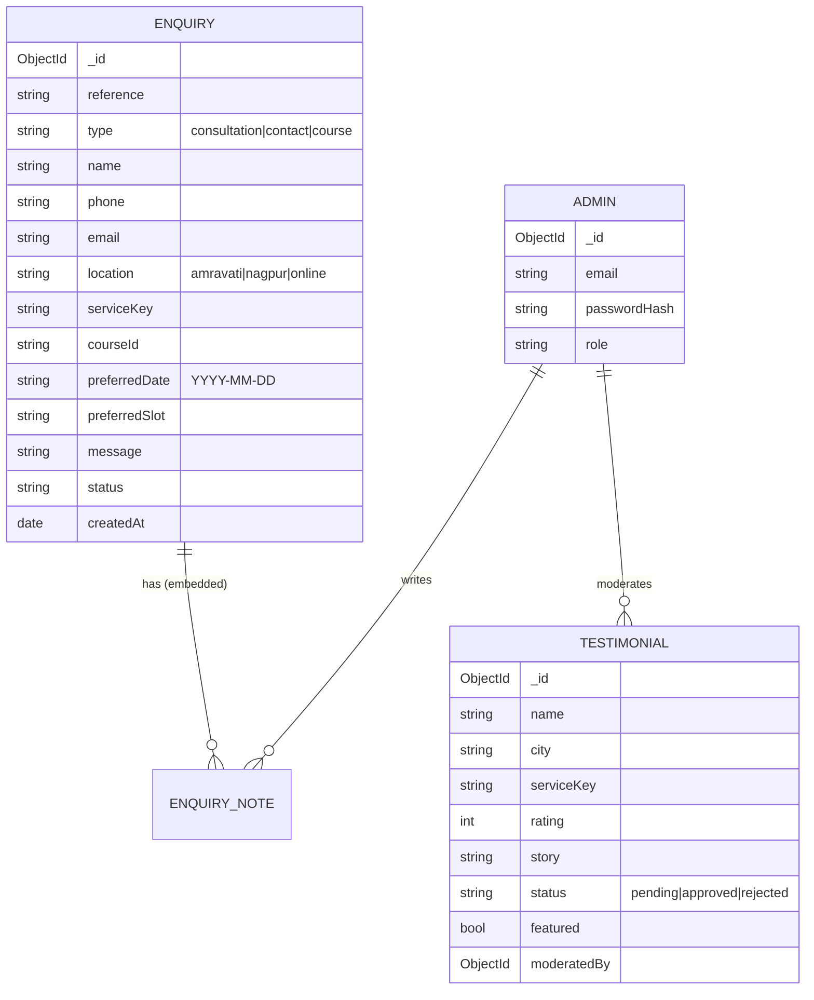
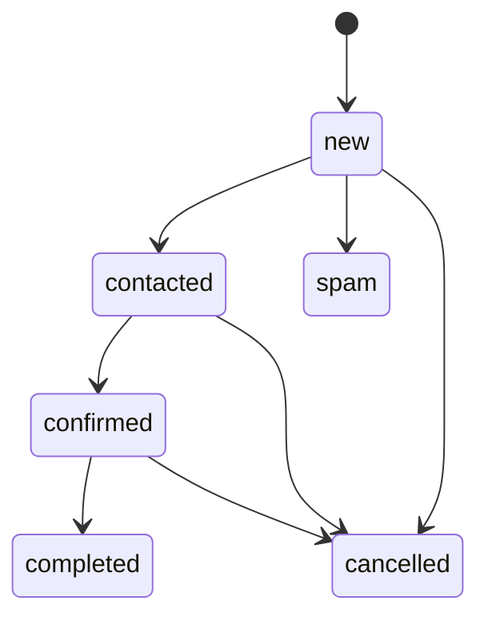
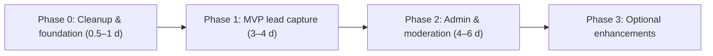

# Reiki & Vaastu World: Backend Discovery & System Analysis

> [!NOTE]
> This is analysis only. I haven't modified, installed or generated anything. Every finding is labelled **[Confirmed]** (seen in the code, with a file reference) or **[Assumption]** (needs your input).

---

## 0. Inspection Coverage

| Area | Status |
|---|---|
| `App.jsx`, `main.jsx`, `index.html`, `vite.config.js`, all `package.json` files | Fully read |
| All **rendered** components (Navbar, Hero, AboutAndFeatures, CoursesGrid, CoursesPage, CourseDetailPage, OurFeatures, BusinessNeeds, ReikiTherapy, VideoTestimonials, Footer, FloatingWidgets, Modals) | Fully read |
| `data/landingData.js`, `data/categories.js` | Fully read |
| `data/courseDetails.js` (967 lines) | Header and the first course read. I verified all 15 keys and grepped for price, fee, ₹, duration, batch, schedule, payment, order and level. There were **no matches**. |
| `backend/server.js`, `backend/models/Agent.js` | Fully read |
| **Orphaned** components (ExploreView, BecomeSellerView, MarketplaceCarousel, HowItWorks, SellerProcess, TechStack) and `data/agents.js` | I scanned these for forms and handlers and confirmed nothing imports them. I didn't read them line by line. |
| `index.css`, `App.css`, `CourseDetailPage.css` | Not inspected (styling only, with no backend relevance) |
| Images, video, logos | I listed them but didn't open them |
| Git history | Not inspected |

---

## 1. Understanding of the Project

**[Confirmed]** **Reiki & Vaastu World** is the website for a real, established practice:

- **Founder:** Dr. Naresh Chhabdiya, who has practised Reiki, Vaastu, Rudraksha, Astrology and Numerology since 1995 ([AboutAndFeatures.jsx](file:///d:/work/Reiki_Vastu/frontend/src/components/AboutAndFeatures.jsx#L29-L62))
- **Physical centres:** Amravati (Walcut Compound) and Nagpur (Mahal), plus online video consultations ([Footer.jsx](file:///d:/work/Reiki_Vastu/frontend/src/components/Footer.jsx#L137-L165))
- **Positioning:** "Training & Treatment Center". It both **treats clients** (consultations and healing sessions) and **trains students** (courses).
- **Offerings:**
  - **15 courses**, which are descriptive only and have no price, duration, batch or date ([CoursesGrid.jsx](file:///d:/work/Reiki_Vastu/frontend/src/components/CoursesGrid.jsx#L4-L130))
  - **7 consultation services**: Vaastu audits, Kundali, Reiki attunement, Lama-Fera, Numerology and Acupressure ([Modals.jsx](file:///d:/work/Reiki_Vastu/frontend/src/components/Modals.jsx#L4-L12))
  - **Products**, which are explicitly "Coming Soon" ([BusinessNeeds.jsx](file:///d:/work/Reiki_Vastu/frontend/src/components/BusinessNeeds.jsx#L136))
  - Free meditation, free counselling and lifetime entry, which are marketing claims ([OurFeatures.jsx](file:///d:/work/Reiki_Vastu/frontend/src/components/OurFeatures.jsx))
- **Business model:** a **lead-generation site with manual follow-up**. Every success message says the team will **"contact you shortly via phone or WhatsApp"** or **"confirm your slot via call or WhatsApp"** ([Modals.jsx L287](file:///d:/work/Reiki_Vastu/frontend/src/components/Modals.jsx#L287), [L421](file:///d:/work/Reiki_Vastu/frontend/src/components/Modals.jsx#L421)). Nothing is priced or sold online.
- **Audience:** spiritual seekers, Vaastu clients (residential and commercial), and prospective students, mostly in Maharashtra, with online clients elsewhere.

**Conclusion:** the backend's main job is to **reliably capture, deliver and help manage enquiries and consultation requests**, and to **moderate testimonials**. It is not e-commerce, an LMS or a marketplace.

---

## 2. Existing Frontend & User Journeys

### 2.1 Architecture [Confirmed]
- React 19 + Vite 8 with vanilla CSS and `lucide-react`. There's **no router**: views switch through `useState` (`home` / `courses` / `course-detail`) in [App.jsx](file:///d:/work/Reiki_Vastu/frontend/src/App.jsx#L16-L52).
- All modals live in one component, [Modals.jsx](file:///d:/work/Reiki_Vastu/frontend/src/components/Modals.jsx), and are opened with `openModal(type, data)`.
- **The frontend makes no API calls at all.** There's no `fetch` or `axios`, no `localStorage`, no env vars and no Vite proxy.

### 2.2 User journeys

| # | Journey | Entry points | Current behaviour |
|---|---|---|---|
| J1 | **Book a consultation** | Navbar "Book Consultation" (desktop and mobile), Hero "Book a Consultation", About "Book Session with Dr. Naresh", Reiki "Book a Reiki Session", Footer "Book Consultation", floating widget "Schedule Personal Consultation" | The form submits, shows fake success for 2.8 s and **the data is discarded** |
| J2 | **General contact enquiry** | Floating widget "Send Query / Center Enquiry" only | The form submits, shows fake success and **the data is discarded** |
| J3 | **Course enrolment enquiry** | Course detail "Enroll in X Course", "Explore X Course" and "Contact Us" | Opens the **consultation modal**. The course title is passed in but **never read** (see bugs). |
| J4 | **Share a testimonial** | "Add Yours" in Testimonials | Fake success saying "will be featured after our team verifies it". **The data is discarded.** |
| J5 | Browse content | Home, Courses grid, Course detail pages, videos | Static, which is fine |
| J6 | Direct contact | `tel:`, WhatsApp `wa.me` link, `mailto:`, social links | Works with no backend |

### 2.3 Unreachable or dead UI [Confirmed]
- **`auth` modal** ("Seeker Portal Login / Register as Student") exists in [Modals.jsx L862-945](file:///d:/work/Reiki_Vastu/frontend/src/components/Modals.jsx#L862-L945), but **nothing calls `openModal('auth')`**.
- **`sandbox` modal** ("Cosmic Diagnosis") is also **unreachable**, and its output is **hard-coded fake text** ([L222-246](file:///d:/work/Reiki_Vastu/frontend/src/components/Modals.jsx#L222-L246)).
- **Six orphaned components** (ExploreView, BecomeSellerView, MarketplaceCarousel, HowItWorks, SellerProcess, TechStack), along with `agents.js` and `categories.js`, are never imported. They look like leftovers from a "marketplace" template.

### 2.4 Existing backend [Confirmed]: [server.js](file:///d:/work/Reiki_Vastu/backend/server.js)

| Endpoint | Problem |
|---|---|
| `GET/POST /api/agents`, `GET /api/agents/:id` | Serves the **orphaned marketplace** template. The `Agent` model has `pricing_model: Free/Freemium/Paid`, `runnable` and similar fields that the live site doesn't use. **`POST /api/agents` lets anyone write to the database with no auth and no validation.** The search builds a `$regex` from raw user input, which allows **ReDoS / regex injection**. |
| `POST /api/contact` | Only `console.log`s the data. Nothing is stored or sent, and the fields don't match either frontend form. |
| `POST /api/newsletter` | **There's no newsletter UI** in the frontend. |
| Config | `cors()` is fully open. There's no helmet, no rate limiting, no validation and no error middleware. Raw `error.message` is returned to clients. PII (name and email) is logged. The `seed` script points to a `seed.js` that **doesn't exist**. |

**Verdict:** the existing backend can't be reused as-is. Keep the Express + Mongoose foundation and replace the routes and model.

### 2.5 Frontend bugs that affect backend data quality [Confirmed]

| # | Issue | Location | Impact |
|---|---|---|---|
| B1 | Course "Enroll" passes `{title}`, but the meeting modal ignores `modalData`, and its default service is "Residential Home Vaastu Audit" | [App.jsx L72-77](file:///d:/work/Reiki_Vastu/frontend/src/App.jsx#L72-L77), [Modals.jsx L174](file:///d:/work/Reiki_Vastu/frontend/src/components/Modals.jsx#L174) | A Meditation-course enquiry arrives as a Vaastu audit request |
| B2 | "Book a Reiki Session" opens a modal that has **no Reiki healing session option** | [ReikiTherapy.jsx L89](file:///d:/work/Reiki_Vastu/frontend/src/components/ReikiTherapy.jsx#L89), [Modals.jsx L4-12](file:///d:/work/Reiki_Vastu/frontend/src/components/Modals.jsx#L4-L12) | The wrong service gets recorded |
| B3 | `meetingForm.time` defaults to `'10:00 AM'`, which isn't one of the `TIME_SLOTS` values (`'10:00 AM (Morning)'`) | [Modals.jsx L177](file:///d:/work/Reiki_Vastu/frontend/src/components/Modals.jsx#L177) | Backend enum validation would fail |
| B4 | `contactForm.center` defaults to `'Amravati Center'`, which isn't one of the options | [Modals.jsx L169](file:///d:/work/Reiki_Vastu/frontend/src/components/Modals.jsx#L169), [L326](file:///d:/work/Reiki_Vastu/frontend/src/components/Modals.jsx#L326) | Same as B3 |
| B5 | `meetingForm.note` is in state, but there's no input for it | [Modals.jsx L178](file:///d:/work/Reiki_Vastu/frontend/src/components/Modals.jsx#L178) | Clients can't describe their concern |
| B6 | The date picker has no `min`, so past dates and Sundays (closed) are allowed | [Modals.jsx L531](file:///d:/work/Reiki_Vastu/frontend/src/components/Modals.jsx#L531) | Invalid requests |
| B7 | Three inconsistent service lists: 15 courses, 7 consultation services and 6 story services | CoursesGrid, Modals | No canonical catalogue |
| B8 | Email typo: `reki.vastuworld@gmail.com` (Modals, About, Navbar) vs `reiki.vastuworld@gmail.com` (Footer) | Multiple | Possibly wrong notification address |
| B9 | Testimonial cards always show 5 stars, even though the form collects a rating | [VideoTestimonials.jsx L25](file:///d:/work/Reiki_Vastu/frontend/src/components/VideoTestimonials.jsx#L25) | The rating data isn't used |
| B10 | Opening hours leave out Saturday | [Footer.jsx L178-198](file:///d:/work/Reiki_Vastu/frontend/src/components/Footer.jsx#L178-L198) | Unclear which days can be booked |
| B11 | Form labels are sent as values (for example `'In-Person (Amravati Center)'`) | Modals | Fragile. Stable keys should be sent instead. |

---

## 3. Confirmed Requirements vs. Assumptions

### 3.1 Confirmed (from the UI)
1. Consultation requests must be captured with: name, phone (required), email (optional), service, mode/location, preferred date and preferred time slot.
2. Contact enquiries must be captured with: name, phone, preferred centre, email (optional) and message.
3. Course enquiries need to be captured **with the course identified** (currently broken, see B1).
4. Testimonials are submitted by the public and **must be moderated** before publishing, because the UI explicitly promises verification.
5. Follow-up is **manual** (phone or WhatsApp), and the business confirms slots itself.
6. Two physical locations plus online.
7. There are **no prices, cart, checkout or payment UI** anywhere.
8. No user account is needed for any reachable journey.

### 3.2 Assumptions requiring your input
See **Section 11: Questions**. The most important ones are: who receives the leads, whether a web admin panel is wanted now, whether time slots need capacity control, and whether the dead auth, sandbox and marketplace code can be deleted.

---

## 4. Page-by-Page Frontend → Backend Gap Analysis

| Page / Component | Existing functionality | Data source | Backend needed? | Recommended backend | Endpoint(s) | Entities | Frontend changes |
|---|---|---|---|---|---|---|---|
| **Navbar** | Nav, `tel:`, opens meeting modal | Static | No (the modal is covered below) | — | — | — | Fix email typo (B8) |
| **Hero** | Video, CTAs | Static | No | — | — | — | None |
| **AboutAndFeatures** | Founder bio, CTA, `mailto:` | Static | No | — | — | — | Fix email typo |
| **CoursesGrid / CoursesPage** | 15 course cards | Hard-coded `COURSES_15` | **No** (for now) | Optional CMS later (P2) | (P2) `GET /api/courses` | Course | None |
| **CourseDetailPage** | Rich descriptive content, Enroll/Contact CTAs | Hard-coded `COURSE_DETAILS` | **Yes, for the CTA only** | Capture a course enquiry linked to `courseId` | `POST /api/enquiries` (`type: course`) | Enquiry | Pass `{ kind:'course', courseId }`. The modal shows course context and sends `courseId`. |
| **OurFeatures** | Marketing copy | Static | No | — | — | — | None |
| **BusinessNeeds (Products)** | "Coming Soon" cards | Static | **No** | (P2, optional) "Notify me" interest list | — | — | None |
| **ReikiTherapy** | Copy and "Book a Reiki Session" | Static | Covered by the meeting modal | — | — | — | Preselect a new `reiki_healing_session` service (B2) |
| **VideoTestimonials: videos** | YouTube embeds | Hard-coded `VIDEO_ITEMS` | No | (P2) manageable video list | — | — | None |
| **VideoTestimonials: testimonials list** | 4 hard-coded testimonials | Hard-coded `TESTIMONIALS_DATA` | **Yes (P1)** | Serve approved testimonials | `GET /api/testimonials` | Testimonial | Fetch with static fallback, and render the real rating |
| **Footer** | Addresses, hours, socials, links | Static | No | — | — | — | Fix hours (B10). Privacy/Terms are non-clickable spans and need real pages. |
| **FloatingWidgets** | Opens meeting/contact modals, WhatsApp link | Static | No (the modals are covered) | — | — | — | None |
| **Modals → Contact** | Form with fake success | Local state | **Yes (P0)** | Validate, store, notify | `POST /api/enquiries` (`type: contact`) | Enquiry | Wire `fetch`, loading and error states, honeypot, stable keys, fix B4 |
| **Modals → Meeting/Schedule** | Form with fake success | Local state | **Yes (P0)** | Validate, store, notify, return a reference number | `POST /api/enquiries` (`type: consultation` or `course`) | Enquiry | Wire `fetch`, read `modalData`, add a Note field, fix B3/B5/B6, date `min` |
| **Modals → Add Story** | Form with fake success | Local state | **Yes (P0)** | Store as `pending` and notify admin | `POST /api/testimonials` | Testimonial | Wire `fetch`, loading and error states |
| **Modals → Auth** | Login/signup form with no state | None (unreachable) | **No, pending your decision** | (P2) Student portal | — | — | Recommend removing or hiding it until it's confirmed |
| **Modals → Sandbox** | Fake "diagnosis" | Hard-coded (unreachable) | **No** | Don't back it | — | — | Recommend removing it (fake diagnostic and health-claim risk) |
| **Orphaned marketplace components** | Not rendered | `agents.js` | **No** | Delete `/api/agents` and the `Agent` model | — | — | Delete the orphaned files once you approve |

### Buttons and forms that look functional but need a backend
1. Contact modal → **Send Enquiry**
2. Meeting modal → **Confirm Booking** (reached from 7 entry points)
3. Course detail → **Enroll in X Course** / **Explore X Course** (through the meeting modal)
4. Add Story modal → **Submit Story**
5. Auth modal → **Log In / Create Free Account** (unreachable, so not recommended)

---

## 5. Recommended Backend Features (Prioritised)

| ID | Feature | Priority | Why | Depends on | Complexity |
|---|---|---|---|---|---|
| F1 | **Enquiry capture API** (consultation, contact and course in one collection) | **P0** | Without it, every lead is lost | F5, F6 | M (1–1.5 d) |
| F2 | **Admin email notification** for each enquiry | **P0** | Turns stored leads into action, since staff call clients back | F1 | S (0.5 d) |
| F3 | **Testimonial submission** (stored as `pending`, admin notified) | **P0** | The UI promises verification, and submissions are currently lost | F5, F6 | S (0.5 d) |
| F4 | **Catalogue constants** (services, courses, locations, slots as stable keys) shared by frontend and backend | **P0** | Needed for enum validation and to fix B1–B4, B7 and B11 | — | S (0.5 d) |
| F5 | **Validation and sanitisation layer** (zod) | **P0** | Prevents bad or malicious data | — | S |
| F6 | **Security baseline**: helmet, CORS allowlist, rate limiting, honeypot, body-size limit, central error handler, safe logging, **removing the open `POST /api/agents`** | **P0** | Public write endpoints will be spammed | — | S–M (0.5–1 d) |
| F7 | **Frontend integration** (API client, loading/error states, bug fixes B1–B6, B8) | **P0** | Connects everything | F1–F4 | M (1 d) |
| F8 | **Customer confirmation email** (only if an email was given) | P1 | A better experience and a reference number. It's optional because email is optional in the forms. | F2 | S |
| F9 | **Admin authentication** (single `admin` role, no public sign-up) | P1 | Needed before any management API | F6 | M (1 d) |
| F10 | **Admin enquiry management**: list, filter, search, paginate, status workflow, notes | P1 | Lets staff track follow-ups instead of digging through email | F9 | M (1–1.5 d) |
| F11 | **Testimonial moderation and public listing** | P1 | Completes the "verified then featured" promise | F3, F9 | S–M (1 d) |
| F12 | **Minimal admin UI** (an `/admin` area in the existing Vite app) | P1 | Staff need a screen to use F10 and F11 | F9–F11 | M–L (2–3 d) |
| F13 | CAPTCHA (Cloudflare Turnstile / reCAPTCHA) | P1 (if spam appears) | Protection beyond the honeypot | F6 | S |
| F14 | Slot availability and capacity rules | P2 | Only needed if manual confirmation stops scaling | F10, business rules | M–L |
| F15 | WhatsApp / SMS notifications (WhatsApp Business API, MSG91, Twilio) | P2 | Matches how the business already works, but costs money and needs Meta approval | F2 | M |
| F16 | Google Calendar sync for confirmed appointments | P2 | Convenience | F10 | M |
| F17 | Course / video / testimonial **CMS** | P2 | Only if the client edits content often. `courseDetails.js` is deeply nested, so a CMS is costly to build. | F9 | L |
| F18 | Products catalogue / "notify me" list | P2 | Products are "Coming Soon" | Business decision | M |
| F19 | Student portal (auth, materials, certificates) | P2, **not recommended until confirmed** | The auth modal is unreachable and no materials or certificates exist | Business decision | L |
| F20 | Online payments | **Not recommended** | No prices, fees or checkout anywhere. Follow-up is manual. | Business decision | L |
| F21 | Newsletter | **Not recommended** | No UI exists. Remove the existing stub. | — | — |
| F22 | Analytics (GA4 / Plausible) | P2 | A frontend-only snippet. No backend needed. | — | S |

---

## 6. Database Design

### 6.1 Database choice: **MongoDB (Atlas) + Mongoose** (keep it)
- **Why:** it's already in the project, you know it, and the enquiry types have different optional fields, which documents handle well. There are no relational joins or multi-table transactions to justify SQL.
- **Trade-off:** SQL would give stricter integrity. With only 2–3 collections and no relationships between them, that benefit is small. Strict Mongoose schemas plus zod give enough integrity.

### 6.2 Entities & relationships



### 6.3 `Enquiry` (P0)

```js
{
  reference:   String,  // unique, e.g. "RVW-261013-4F7K" (for phone follow-up)
  type:        { enum: ['consultation', 'contact', 'course'], required },
  name:        { String, required, trim, 2–80 chars },
  phone:       { String, required },           // normalised, e.g. "+919823456789"
  email:       { String, lowercase, optional },
  location:    { enum: ['amravati', 'nagpur', 'online'], required },
  // consultation-only
  serviceKey:    { enum: CONSULTATION_SERVICE_KEYS },
  preferredDate: { String /* 'YYYY-MM-DD' in IST, avoids TZ shift */ },
  preferredSlot: { enum: ['10:00', '12:30', '16:30', '18:30'] },
  // course-only
  courseId:    { enum: COURSE_IDS /* 15 ids from CoursesGrid */ },
  // shared
  message:     { String, max 1000 },
  status:      { enum: ['new','contacted','confirmed','completed','cancelled','spam'], default: 'new' },
  confirmed:   { date: String, slot: String },  // P1, set by admin
  notes:       [{ text, by: ObjectId(Admin), at: Date }],  // P1
  notification:{ adminEmailSent: Boolean, customerEmailSent: Boolean, lastError: String },
  meta:        { sourcePage: String, userAgent: String, ipHash: String },  // hashed IP, not raw
  timestamps:  true
}
// Indexes: {reference:1} unique, {status:1, createdAt:-1}, {type:1, createdAt:-1}, {phone:1}
```

> [!TIP]
> **Why one collection instead of three:** staff treat every form as "a lead to call back", so a single inbox with one status workflow is simpler to build, query and present. Type-specific rules are enforced by a zod **discriminated union** on `type`.

### 6.4 `Testimonial` (P0 submit, P1 moderate)

```js
{
  name:        { String, required, 2–80 },
  city:        { String, required, 2–80 },
  serviceKey:  { enum: STORY_SERVICE_KEYS, required },
  rating:      { Number, int, min 1, max 5, required },
  story:       { String, required, 20–1000 },
  status:      { enum: ['pending','approved','rejected'], default: 'pending' },
  displayRole: String,           // admin-edited label, e.g. "Reiki Master Student"
  featured:    { Boolean, default: false },
  sortOrder:   Number,
  moderatedBy: ObjectId(Admin), moderatedAt: Date,
  meta:        { userAgent, ipHash },
  timestamps:  true
}
// Index: {status:1, featured:-1, sortOrder:1, createdAt:-1}
```

### 6.5 `Admin` (P1)

```js
{ name, email: unique lowercase, passwordHash /* bcrypt cost 12 */,
  role: { enum: ['admin'], default: 'admin' }, isActive: Boolean,
  lastLoginAt: Date, tokenVersion: Number /* to invalidate sessions */, timestamps }
```
Created with a CLI script (`npm run create-admin`). **There's no public sign-up.**

### 6.6 Public vs. private data

| Data | Visibility |
|---|---|
| Courses, services, centres, hours, videos | Public (static) |
| Approved testimonials: name, city, role, story, rating | Public |
| Enquiries: name, phone, email, message, IP hash | **Private** (admin only) |
| Pending or rejected testimonials | **Private** |
| Admin credentials | **Private**, never returned |

### 6.7 Remove
The `Agent` model and the `reiki_vastu_world.agents` collection, once you approve.

---

## 7. API Specification

**Conventions**
- Base path is `/api`. Bodies are JSON. The maximum body size is **10 kb**.
- Success responses look like `{ "success": true, "data": …, "message"?: … }`.
- Error responses look like `{ "success": false, "error": { "code", "message", "fields"? } }`.
- Raw error messages and stack traces are never returned.

### 7.1 Public endpoints

#### `GET /api/health`: liveness and DB check
- Returns `200 { status:'ok', db:'connected' }`, or `503` if the database is down.

#### `POST /api/enquiries`: P0 (contact, consultation, course)
- **Access:** public, rate-limited (for example 5 requests per 10 minutes per IP).
- **Shared fields:** `type`, `name`, `phone`, `email?`, `location`, `message?`, `website` (honeypot, must be empty), `sourcePage?`.
- **Validation by type:**

| Field | contact | consultation | course |
|---|---|---|---|
| `message` | **required**, 5–1000 | optional, ≤1000 | optional, ≤1000 |
| `serviceKey` | — | **required**, enum | — |
| `preferredDate` | — | **required**, `YYYY-MM-DD`, not in the past, ≤ 90 days ahead, not a Sunday | optional |
| `preferredSlot` | — | **required**, enum | optional |
| `courseId` | — | — | **required**, one of the 15 IDs |

- **Common rules:**
  - `name` is 2–80 characters, letters, spaces and `.'-` only.
  - `phone` is an Indian mobile (`^(\+91|0)?[6-9]\d{9}$`), stored as `+91…`. International numbers depend on Q8.
  - `email` must be valid if present.
  - Unknown fields are rejected (`.strict()`).

Example request (consultation):
```json
{
  "type": "consultation",
  "name": "Mayur Wankhade",
  "phone": "9823456789",
  "email": "mayur@example.com",
  "location": "nagpur",
  "serviceKey": "residential_vaastu_audit",
  "preferredDate": "2026-10-20",
  "preferredSlot": "16:30",
  "message": "3BHK flat, main door facing South-West.",
  "website": ""
}
```
Example request (course):
```json
{ "type": "course", "name": "Anjali Sharma", "phone": "+919812345678",
  "location": "online", "courseId": "reiki", "message": "Interested in Level 1.", "website": "" }
```
Response `201`:
```json
{
  "success": true,
  "data": { "reference": "RVW-261013-4F7K", "type": "consultation", "status": "new" },
  "message": "Request received. Our coordinator will confirm via call or WhatsApp."
}
```
The response deliberately doesn't echo back any personal data.

Errors:

| Status | Code | When |
|---|---|---|
| 400 | `BAD_REQUEST` | Malformed JSON or body too large (413 can also be used) |
| 422 | `VALIDATION_ERROR` | Field errors, returned in `fields: { phone: "Enter a valid 10-digit mobile number" }` |
| 429 | `RATE_LIMITED` | Too many submissions |
| 500 / 503 | `SERVER_ERROR` / `SERVICE_UNAVAILABLE` | Unexpected error or DB down |
| *(201)* | — | **Honeypot filled:** return a fake success and store nothing, so bots get no signal |

**Side effects:** save → respond → send the admin email asynchronously. A failed email **doesn't fail the request**; it's recorded in `notification.lastError`. P1 adds a customer confirmation email.

#### `POST /api/testimonials`: P0
- **Access:** public, rate-limited (for example 3 requests per hour per IP).
- **Body:** `{ name, city, serviceKey, rating (1–5), story (20–1000), website }`
- **Response `201`:** `{ success:true, message:"Thank you! Your story will be featured after verification." }`
- **Errors:** 400, 422, 429, 500.

#### `GET /api/testimonials`: P1
- **Access:** public, cacheable (`Cache-Control: public, max-age=300`).
- **Query:** `limit` (1–50, default 20).
- Returns **approved** testimonials only, ordered by featured, then sort order, then newest.
- **Response:** `{ data: [{ id, name, city, role, story, rating }] }`. Only public fields are returned.

### 7.2 Admin endpoints (P1, all require an admin session)

| Method & Path | Purpose | Request | Response / Errors |
|---|---|---|---|
| `POST /api/admin/auth/login` | Log in | `{ email, password }` | `200` and sets an httpOnly cookie. `401` invalid credentials (generic message). `429` after 5 attempts per 15 minutes. |
| `POST /api/admin/auth/logout` | Log out | — | `204` |
| `GET /api/admin/auth/me` | Current admin | — | `200 { id, name, email }` / `401` |
| `GET /api/admin/enquiries` | List | Query: `type`, `status`, `location`, `q` (escaped text search on name, phone, reference), `from`, `to`, `page`, `limit` (≤100), `sort` | `200 { data, pagination:{ page, limit, total, pages } }` |
| `GET /api/admin/enquiries/:id` | Detail | — | `200` / `400` invalid ID / `404` |
| `PATCH /api/admin/enquiries/:id` | Update | `{ status?, note?, confirmed?: { date, slot } }` | `200` / `422` / `404` / `409` invalid status transition |
| `DELETE /api/admin/enquiries/:id` | Hard delete (for data-erasure requests) | — | `204` / `404` |
| `GET /api/admin/testimonials` | List | `status`, `page`, `limit` | `200` paginated |
| `PATCH /api/admin/testimonials/:id` | Moderate | `{ status?, displayRole?, featured?, sortOrder? }` | `200` / `422` / `404` |
| `DELETE /api/admin/testimonials/:id` | Remove | — | `204` / `404` |

**Authorisation:**
- An `requireAdmin` middleware verifies the JWT from the cookie, checks `isActive` and `tokenVersion`, and returns `401` if any check fails.
- There's only one role, so there's no `403` case yet. Add a `staff` role later only if needed.

**Enquiry status workflow:**


### 7.3 Endpoints to delete
`GET/POST /api/agents`, `GET /api/agents/:id`, `POST /api/contact` (replaced by `/api/enquiries`) and `POST /api/newsletter`.

---

## 8. Backend Architecture

### 8.1 Stack (all compatible with what's already there)

| Concern | Choice | Reason |
|---|---|---|
| Runtime / framework | **Node.js 20+ and Express 4** (already present) | Matches your experience and the existing code |
| DB / ODM | **MongoDB Atlas and Mongoose 8** (already present) | See §6.1 |
| Validation | **zod** | One schema gives validation, types and clean errors, and discriminated unions suit the enquiry types. `express-validator` would also work. |
| Security | `helmet`, `cors` (allowlist), `express-rate-limit` | Standard and lightweight |
| Email | **Nodemailer** behind an `emailService` interface | Works with any SMTP provider (Gmail app password, Brevo, Resend SMTP), so you can switch without code changes |
| Auth (P1) | `bcrypt` and `jsonwebtoken` in an **httpOnly, Secure, SameSite=Lax cookie** | Stateless and simple for a single admin. The token isn't reachable from JavaScript, which protects it from XSS. |
| Logging | `pino` and `pino-http` with phone and email **redacted** | Structured logs without leaking personal data |
| Testing | `vitest` or `jest`, `supertest` and `mongodb-memory-server` | Endpoint tests without a real database |
| File storage | **None needed** | No uploads exist anywhere in the UI |

**Not introduced:** TypeScript (optional), Redis, queues, GraphQL, microservices, Docker (optional). The traffic and scope don't justify them.

### 8.2 Project structure

```
backend/
├── src/
│   ├── app.js                 # express app: middleware + routes (no listen → testable)
│   ├── server.js              # connects DB, starts server, graceful shutdown
│   ├── config/
│   │   ├── env.js             # zod-validated process.env (fail fast on missing vars)
│   │   └── db.js
│   ├── models/                # Enquiry.js, Testimonial.js, Admin.js (P1)
│   ├── validators/            # enquiry.schema.js, testimonial.schema.js, admin.schema.js
│   ├── routes/                # public.routes.js, admin.routes.js (P1)
│   ├── controllers/           # thin: parse → call service → respond
│   ├── services/              # enquiry.service.js, testimonial.service.js, email.service.js
│   ├── middleware/            # validate.js, rateLimiters.js, honeypot.js, requireAdmin.js,
│   │                          # notFound.js, errorHandler.js
│   ├── templates/email/       # adminNewEnquiry.js, customerConfirmation.js (HTML-escaped)
│   └── utils/                 # logger.js, phone.js, reference.js, escapeHtml.js, AppError.js
├── scripts/createAdmin.js     # P1
├── tests/
├── .env.example
└── package.json

shared/                         # NEW npm workspace (the root already uses workspaces)
└── catalog.js                  # LOCATIONS, CONSULTATION_SERVICES, COURSE_IDS, TIME_SLOTS, STORY_SERVICES
                                # → imported by BOTH frontend dropdowns and backend validators
```

> [!TIP]
> **The `shared/catalog.js` workspace** is the clean fix for B3, B4, B7 and B11. The dropdowns show `label` and submit `key`, and the backend validates against the same keys. If you'd prefer not to add a workspace, the backend can expose `GET /api/catalog` instead, at the cost of an extra request.

### 8.3 Environment variables (`.env.example`)

```
NODE_ENV=development
PORT=5000
MONGO_URI=mongodb+srv://...
CORS_ORIGINS=http://localhost:5173,https://www.reikiandvastuworld.com
TRUST_PROXY=1                      # needed behind Render/Nginx for correct rate-limit IPs
IP_HASH_SALT=change-me
# Email
SMTP_HOST=  SMTP_PORT=587  SMTP_USER=  SMTP_PASS=
MAIL_FROM="Reiki & Vaastu World <no-reply@reikiandvastuworld.com>"
ADMIN_NOTIFY_EMAILS=reiki.vastuworld@gmail.com      # comma-separated
SEND_CUSTOMER_CONFIRMATION=false
# P1
JWT_SECRET=<32+ random bytes>
JWT_EXPIRES_IN=8h
COOKIE_DOMAIN=
```
Frontend: `VITE_API_BASE_URL` for production, plus a Vite dev proxy from `/api` to `http://localhost:5000`.

### 8.4 Error-handling strategy
- An `AppError(status, code, message, fields?)` class is thrown from services.
- An async route wrapper (or Express 5) forwards errors to one central `errorHandler`:
  - ZodError → 422
  - Mongoose CastError → 400
  - Duplicate key → 409
  - JSON parse error → 400
  - Anything else → 500 with a generic message, with the full error logged server-side.
- A `notFound` handler covers unknown `/api/*` routes.
- `unhandledRejection` and `SIGTERM` handlers close the DB and server gracefully.

### 8.5 Deployment options

| Option | Setup | Pros | Cons |
|---|---|---|---|
| **A (recommended)** | Frontend on Vercel or Netlify at `www.reikiandvastuworld.com`. API on Render or Railway at `api.reikiandvastuworld.com`. MongoDB Atlas (free M0). | Free or cheap tiers, simple CI from Git. **The same parent domain means SameSite=Lax cookies work for admin.** | Free Render instances sleep, giving a slow first request (paid tier about $7/month avoids this) |
| B | One VPS (or Render) where Express serves the built `frontend/dist` as well as `/api` | Single origin, so no CORS. One deploy. | You manage the server, and frontend deploys are coupled to the backend |

Email deliverability: for customer confirmations, use a domain sender with **SPF and DKIM** through Brevo or Resend. Gmail SMTP is fine for admin-only notifications.

### 8.6 Frontend integration
- Add `src/api/client.js`: a small `fetch` wrapper with base URL, JSON handling, timeout and mapping of the `{success, error}` shape.
- Modals: add `isSubmitting` and `error` state, show field errors from `error.fields`, show success with `reference` **only after a 201**, disable the button while submitting, add a hidden honeypot input, and reset the form after success.
- Course and Reiki CTAs: `openModal('meeting', { kind:'course', courseId })` / `{ serviceKey:'reiki_healing_session' }`. The modal reads `modalData`.
- The admin UI (P1) needs routing. Add `react-router-dom` with an `/admin` route, or a separate Vite entry (`admin.html`). The public site's state-based navigation can stay as it is.

---

## 9. Security & Production Readiness

| Risk | Mitigation |
|---|---|
| **Open write endpoint** (`POST /api/agents`) | Delete it |
| Spam / bot submissions | Rate limits per route, a honeypot field, a strict body-size limit, and Turnstile later if needed (F13) |
| NoSQL operator injection | zod `.strict()` schemas accept only primitive values. Never pass `req.body` straight into Mongoose. Set `mongoose.set('sanitizeFilter', true)`. |
| ReDoS / regex injection in admin search | Escape user input before `$regex` (or use a `$text` index), and cap the length of `q` |
| **HTML injection into admin emails** | HTML-escape every user field in email templates. Plain-text alternatives are also sent. |
| XSS through testimonials | React escapes output by default. Never use `dangerouslySetInnerHTML`, and store plain text only. |
| Broken auth (P1) | bcrypt (cost 12), generic login errors, login rate limit, httpOnly/Secure/SameSite cookies, short JWT expiry, `tokenVersion` revocation, and no public sign-up |
| CSRF (P1) | SameSite=Lax cookie plus a JSON-only content type check on state-changing admin routes. Add a CSRF token if you ever go cross-site. |
| Secrets | Kept only in `.env`, which is already in `.gitignore` ✔. Validated at boot with zod. Different secrets per environment. |
| Info leakage | No stack traces or `error.message` in responses. `helmet` removes `X-Powered-By`. |
| PII in logs | pino `redact` for phone and email. **Remove the current `console.log` of names and emails.** |
| Personal data (India **DPDP Act 2023**) | Add a short consent line under each form linking to a real Privacy Policy page (the footer text currently isn't a link). Collect only what's needed, store hashed IPs, set a retention policy (for example, delete `spam` and `cancelled` enquiries after 12 months), and support deletion requests (admin DELETE). |
| CORS | An explicit origin allowlist from env |
| Availability | Atlas automated backups, a `/api/health` check for uptime monitoring (for example UptimeRobot), and a graceful shutdown |
| Correct client IPs | `app.set('trust proxy', TRUST_PROXY)` behind a load balancer, or the rate limiter will treat every user as the same IP |
| Dependency hygiene | `npm audit` in CI and a pinned Node version (`engines`) |

---

## 10. Phased Implementation Roadmap



### Phase 0: Cleanup & foundation (about 0.5–1 day)
1. Remove the `Agent` model and the `/api/agents`, `/api/contact` and `/api/newsletter` routes, plus the orphaned frontend components if you approve.
2. Set up the `src/` structure, `config/env.js`, `.env.example`, `errorHandler`, `notFound`, helmet, the CORS allowlist, the JSON body limit, the pino logger and `/api/health` with a DB check.
3. Create `shared/catalog.js` with stable keys.

### Phase 1: MVP, lead capture working end to end (about 3–4 days). **This is the smallest complete backend.**
| Step | Deliverable | Depends on | Complexity |
|---|---|---|---|
| 1 | `Enquiry` model, zod discriminated-union schema, `POST /api/enquiries` | Phase 0 | M |
| 2 | Rate limiters and honeypot middleware | Phase 0 | S |
| 3 | `emailService` (Nodemailer) and an HTML-escaped admin notification template | 1 | S |
| 4 | `Testimonial` model and `POST /api/testimonials` (pending, admin notified) | 1, 2, 3 | S |
| 5 | Frontend: API client, wiring the 3 modals, loading and error states, fixes for B1–B6 and B8 | 1, 4, catalogue | M |
| 6 | Tests with supertest (happy path, validation, honeypot, rate limit) | 1–4 | S–M |
| 7 | Deploy (Atlas, Render or Railway, Vercel or Netlify), env config, uptime check | 1–6 | S |

**Outcome:** every form on the live site stores its data, the business gets an email within seconds, and the site is protected against spam and abuse. Staff work leads from their inbox, as they do today, but nothing is lost anymore.

### Phase 2: Admin & moderation (about 4–6 days)
Admin model and `createAdmin` script → auth endpoints → enquiry list, detail, update and delete → testimonial moderation → public `GET /api/testimonials` (the frontend fetches it, with the static list as fallback) → optional customer confirmation email → minimal `/admin` UI (login, enquiry table with filters and status changes, testimonial approval queue).

### Phase 3: Optional, driven by demand
Turnstile CAPTCHA, WhatsApp or SMS alerts, slot capacity rules, Google Calendar sync, a CMS for courses and videos, a products "notify me" list, analytics. Payments and the student portal come only after the business confirms it wants them.

---

## 11. Questions for You

1. **Lead recipients:** which email address(es) should receive notifications? Is the correct address `reiki.vastuworld@gmail.com` or `reki.vastuworld@gmail.com`?
2. **Admin panel timing:** is email notification enough for launch, with the web admin panel in Phase 2? Or do staff need a dashboard from day one? How many people need access?
3. **Booking model:** should the system stay as "request, then manual confirmation by phone" (what the UI says now)? Or do you need real slot availability or capacity limits per centre? Are the four time slots the same for both centres and online?
4. **Operating days:** should the backend reject Sundays and past dates? What are the **Saturday** hours (missing from the footer)?
5. **Courses:** is "Enroll" just an enquiry, or are there batches, dates or fees the site should eventually show? Is online payment ever planned?
6. **Products:** will they be sold online? If so, roughly when? (This affects whether a "notify me" list is worth building.)
7. **Dead code:** can I **delete** the unreachable `auth` and `sandbox` modals, the six orphaned marketplace components, `agents.js`, `categories.js` and the `Agent` backend?
8. **Phone numbers:** do you need to accept **international** numbers for online clients, or only Indian mobiles?
9. **Customer emails:** should clients who give an email get an automatic confirmation? Do you have (or want) a sending domain such as `no-reply@reikiandvastuworld.com`?
10. **Testimonials:** should submitted ratings be displayed? Should staff be able to edit the wording before publishing?
11. **Hosting:** is `reikiandvastuworld.com` already hosted somewhere (an existing site, cPanel or VPS)? Do you prefer free-tier hosting, or is a small monthly cost (about $7–10) acceptable?
12. **Legal:** do Privacy Policy and Terms pages exist, or should they be added as part of this work?
13. **Content editing:** how often will course text, videos or testimonials change? Does the client need to edit them without a developer?

---

## 12. Final Recommendation

### Build first: the smallest complete backend
1. **`POST /api/enquiries`**: one endpoint and one `Enquiry` collection for **contact, consultation and course** requests, with strict zod validation and a reference number.
2. **`POST /api/testimonials`**: stored as `pending`.
3. **Admin email notification** for every submission (Nodemailer), sent without blocking the response.
4. **Security baseline**: helmet, CORS allowlist, per-route rate limits, honeypot, body-size limit, central error handler, PII-safe logging, and **removing the open `/api/agents` write endpoint**.
5. **`shared/catalog.js`** with stable keys, plus **frontend wiring** of the 3 modals, including the course-context and default-value bug fixes.
6. `/api/health`, `.env.example`, a basic test suite and deployment.

That's **2 collections, 3 public endpoints and no authentication**. It covers every user journey the current site actually has.

### Safe to postpone
- **Phase 2:** admin auth and dashboard, enquiry status management, testimonial moderation UI and public `GET /api/testimonials`, customer confirmation emails.
- **Later, only on demand:** CAPTCHA, WhatsApp/SMS alerts, calendar sync, slot capacity rules, course/video CMS, products catalogue.
- **Don't build unless the business asks:** payments, student portal and accounts, newsletter, "Cosmic Diagnosis" sandbox, marketplace/agents.

> [!IMPORTANT]
> I'm waiting for your approval and answers to Section 11 before making any code changes. At minimum I need Q1, Q2, Q3 and Q7 to start Phase 0–1.
